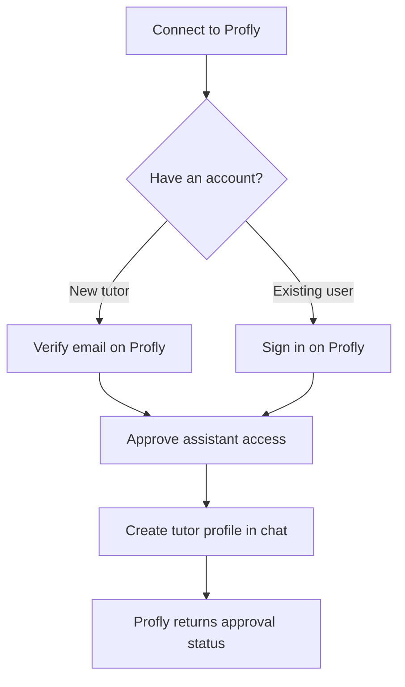

# Profly MCP skill

Prepare a lesson in Claude and save the material in a particular student's Profly space for review.

## What is Profly?

Profly is a teaching workspace for independent tutors who bring their own students. A tutor can share a booking page, set lesson prices, offer prepaid lesson blocks and teach in a browser classroom with video and a shared whiteboard. Each student has a space for their lessons, messages and materials.

The **MCP connector** lets an assistant such as Claude work with parts of that workspace in conversation. For example, you can ask when you next teach Maya, read the exercise you shared last week, and prepare a follow-up for her. The **skill in this repository** gives Claude instructions for tutor signup and lesson preparation. The connected Profly server supplies the tools and decides which ones your account can use.

## What can I ask my assistant to do?

| When you want to… | Try asking… | What happens in Profly |
| --- | --- | --- |
| Plan your week | “What lessons do I have next week, and where could I fit a 50-minute lesson with Maya?” | The assistant can read your diary and check available slots. You choose whether to book one. |
| Bring students across | “Set up spaces for Maya and Leo. I’ll invite them later.” | Each student gets a separate space. Email invitations are a separate action you approve. |
| Set up a regular lesson | “Schedule Maya every Tuesday at 18:00 London time.” | The assistant can set up a weekly series. It can also move or cancel an individual lesson under your usual rules. |
| Handle a booking request | “Show me the lesson times students have requested.” | Review pending requests in chat, then choose which to accept or decline. |
| Prepare the next lesson | “Read Maya’s last worksheet and draft a ten-minute warm-up using the same verbs in a new situation.” | The assistant can read materials in Maya’s space and save a new draft there. You review and share it in Profly. |
| Follow up after class | “Draft a message to Maya summarising today’s homework.” | Review the wording in chat. If you ask to send it, the message goes to Maya’s space in your name. |

**Students can use the connector too.** A signed-in student can check their lessons, read materials their tutor has shared, message their tutor and request a lesson time. The tutor can then accept or decline the request.

**Calendar access is optional.** On deployments with Google Calendar import enabled, a tutor can grant the assistant one hour of calendar access in Profly settings. Ordinary Profly diary questions use the lessons already in the workspace.

## Start from your assistant

Add the remote connector using your Profly deployment’s HTTPS address followed by `/api/mcp`. Complete the sign-in and consent screens. A new tutor can use an email link to create their account during this step.

> Create my free Profly tutor account. I teach Italian and my teaching name is Alex.

The assistant can use `create_tutor_account` once the server update is deployed and the connector is enabled. Profly shows whether your tutor profile is awaiting approval. After approval, refresh the connector’s tools to start teaching.

## Prepare a lesson

1. For Claude Code, copy the included `skills/profly-mcp` folder into your project's `.claude/skills/` directory.
2. Try “Prepare a 15-minute A2 Italian exercise on ordering at a restaurant and save it for my student Maya in Profly.”

The connector must be enabled on the Profly deployment. The skill uses the hosted server and its signed-in tutor permissions. Saved materials are private drafts until the tutor shares them from Profly.
