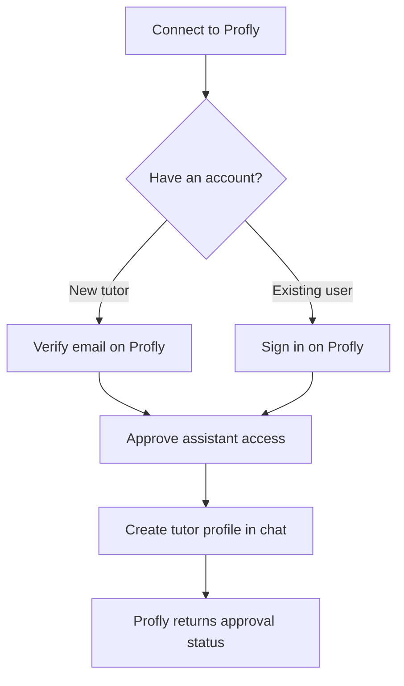

# Profly MCP skill

Prepare a lesson in Claude and save the material in a particular student's Profly space for review.

## Start from your assistant

Add the remote connector using your Profly deployment’s HTTPS address followed by `/api/mcp`. Complete the sign-in and consent screens. A new tutor can use an email link to create their account during this step.

> Create my free Profly tutor account. I teach Italian and my teaching name is Alex.

The assistant can use `create_tutor_account` once the server update is deployed and the connector is enabled. Profly shows whether your tutor profile is awaiting approval. After approval, refresh the connector’s tools to start teaching.

## Prepare a lesson

1. For Claude Code, copy the included `skills/profly-mcp` folder into your project's `.claude/skills/` directory.
2. Try “Prepare a 15-minute A2 Italian exercise on ordering at a restaurant and save it for my student Maya in Profly.”

The connector must be enabled on the Profly deployment. The skill uses the hosted server and its signed-in tutor permissions. Saved materials are private drafts until the tutor shares them from Profly.
